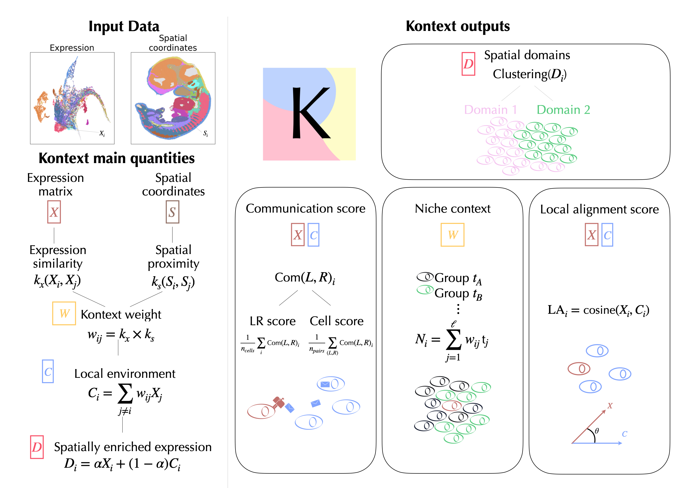

<p align="center">
  
</p>

<h1 align="center">kontext</h1>

<p align="center">
  Kernel-based method bridging spatial domain identification and cell-cell communication.
</p>


# Kontext

**Kontext** is a kernel-based method for identifying interpretable spatial domains from spatial transcriptomics data. It is based on the dual characterization of the cells in a tissue on both their expression and local environment. 
The methods allows to identify spatial domains and interpret them in terms of cell-cell communication, niche analysis and local alignement scoring. 

-> Read our preprint for more details : 


---

<p align="center">
  
</p>


## Installation

### Requirements

- Python **>= 3.12**
- A working C/C++ compiler is recommended for `numba` / `scanpy` dependencies.

<!-- ### From PyPI 

```bash
pip install kontext
``` -->

### From github 

```bash
pip install git+https://github.com/cantinilab/kontext.git
```
### Local installation

```bash
# from the kontext directory
pip install -e .
```

## Getting started 

**Kontext** takes an AnnData object as input with counts in the `X` layer and spatial coordinates encoded in the `obsm` field as `'spatial'`.  

```python
import scanpy as sc
from kontext.kontext_class import Kontext
from kontext.visualization import space_plot
from kontext.utils import get_LR_pairs
# Load AnnData object
path = # Path to your h5ad file 
adata = sc.read_h5ad(path)

# Preprocess your count matrix ('sparse_hvg' for sequencing based technologies and 'image' for image-based technologies)
adata = preprocess_adata(adata,preprocessing='sparse_hvg')

# Initialize Kontext object 
ko = Kontext(sigma_e=1,snn=20,alpha=0.5,verbose=False)

# Compute spatial domains and visualize them
ko.spatial_domains(adata,**spatial_domains)
space_plot(adata,'spatial_domain')

# Compute cell-cell communication  (Kontext handles human and mouse, other organisms should by handled by the user)
pairs = get_LR_pairs(adata, organism='mouse', verbose=False)
ko.cell_cell_communication(adata,pairs)

# Compute specific communication between two subpopulations (encoded as categorical variables in a column of adata.obs)
sender = 'A'
receiver = 'B'
groups = 'column_defining_subpopulations'
ko.init_sender_receiver_communication(adata,pairs,sender,receiver,groups)
ko.sender_receiver_scores(adata,pairs,sender,receiver,groups)


# Compute local alignment 
ko.local_alignment(adata)

# Compute niches (e.g. with respect to cell types)
ko.niche(self, adata, cell_type_key="cell_type")
```